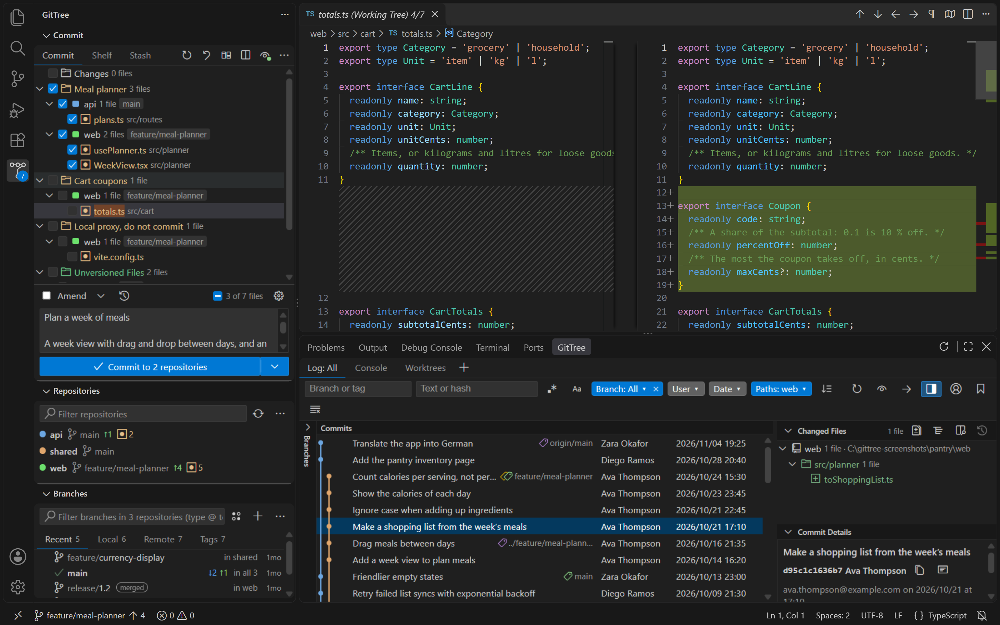
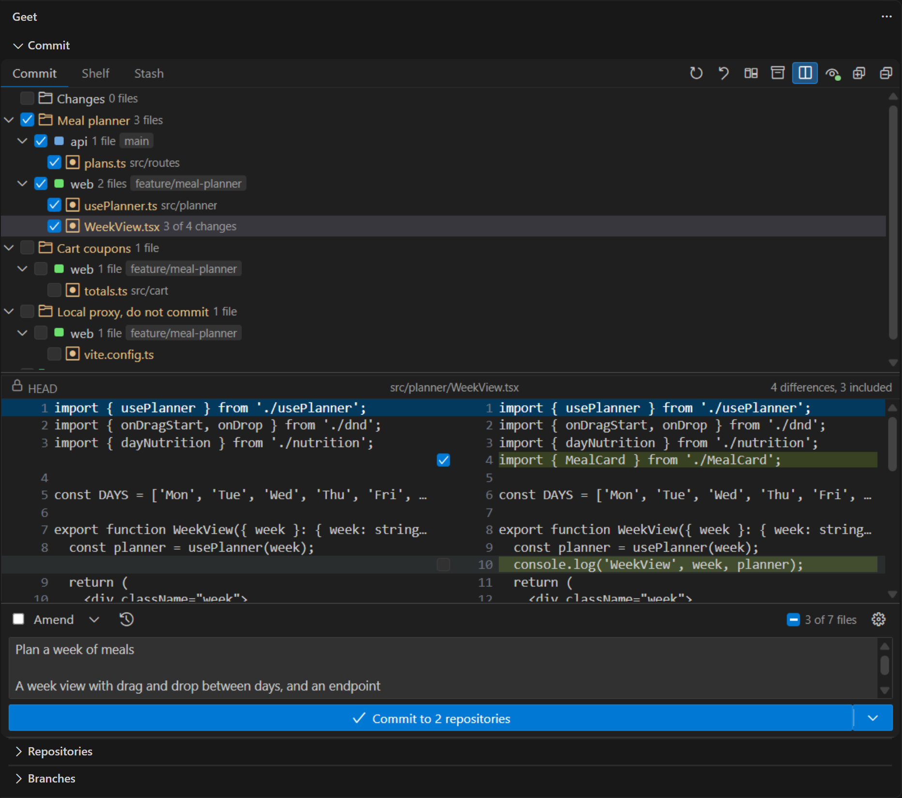
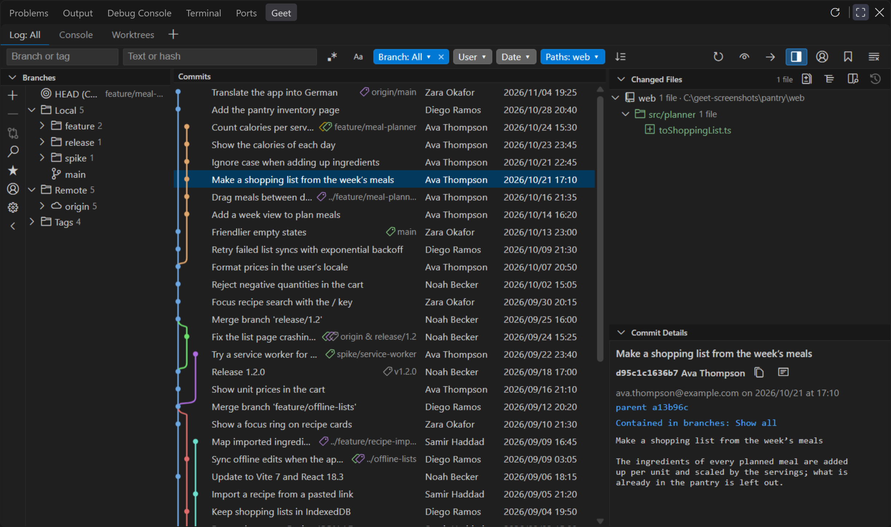
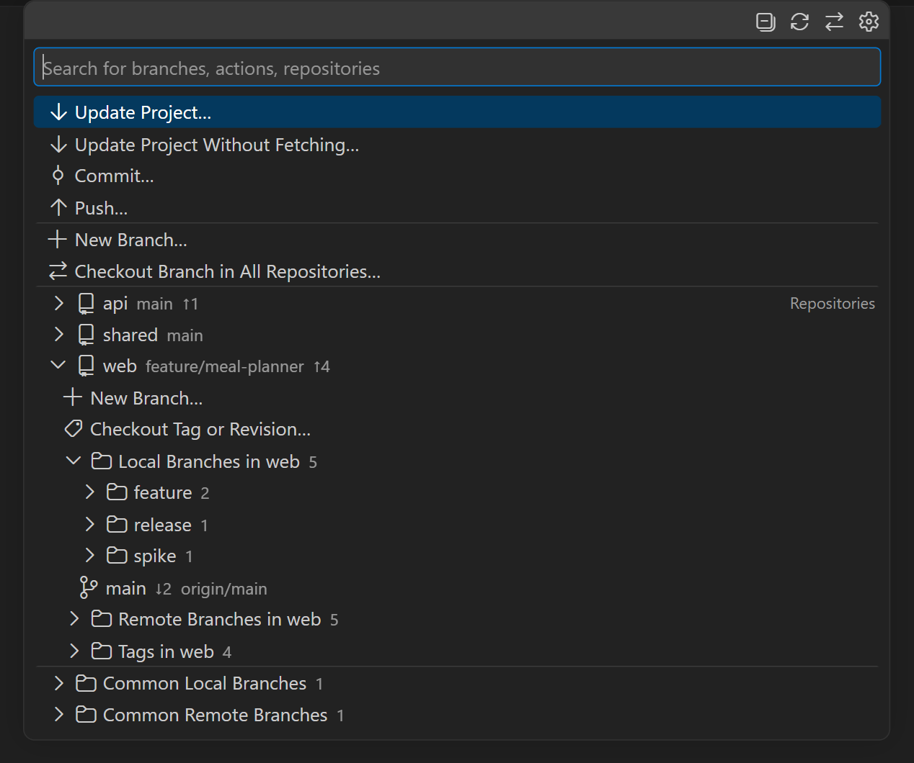
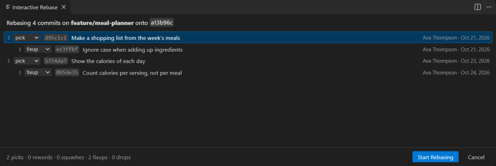
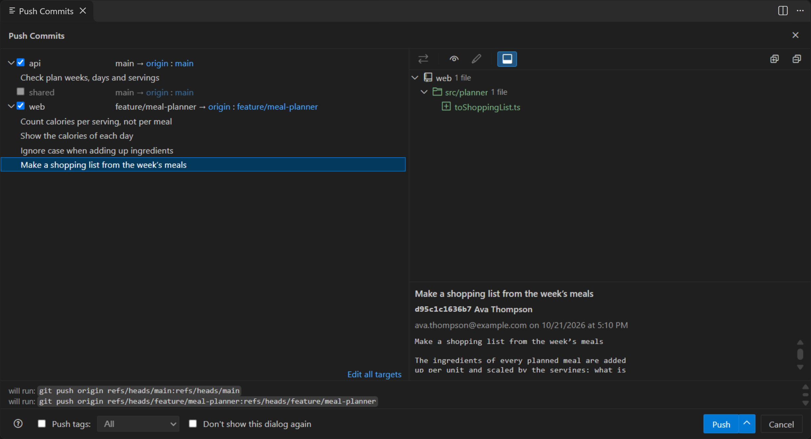
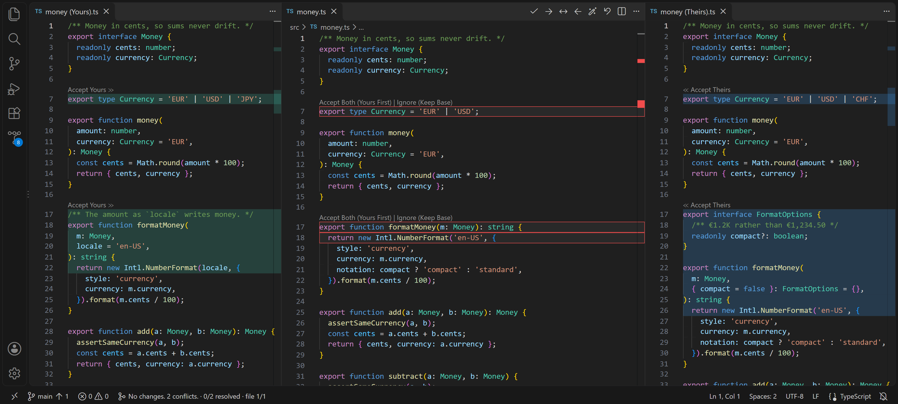
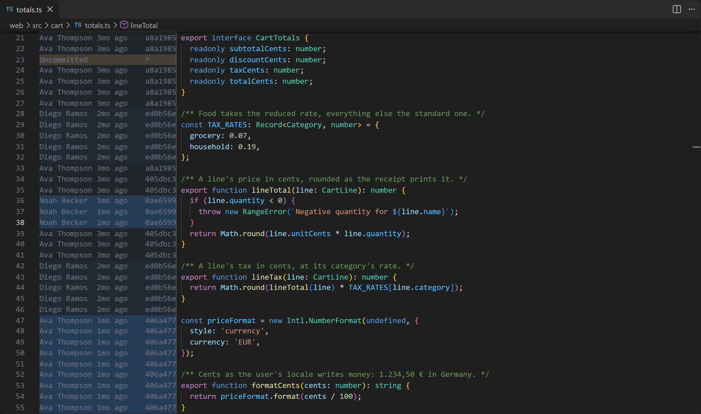

# Geet for Git

**IntelliJ-style Git for VS Code.** Changelists and a real Commit window, a Git
log with a fast commit graph, a branches popup that is an action hub,
interactive rebase, a three-pane merge editor, shelve and Local History, for
one repository or many at once.



Geet brings its own views, so it neither needs nor touches VS Code's
built-in Git extension: leave that one on or turn it off, Geet works the
same.

> **New.** 0.2 is Geet's first stable release. Try it on your projects, and
> [tell us what breaks](https://github.com/ntson9p/geet/issues).

## Highlights

- **Changelists and partial commits.** Sort your changes into named
  changelists, tick the files, or single changes inside a file, that go into a
  commit, and commit to several repositories in one go.
- **The Log you know from IntelliJ.** Branches, commits, changed files and
  details side by side, over a commit graph that stays fast at 100,000
  commits, with filters by branch, user, date and path.
- **Branches.** One popup and one panel for all your repositories: incoming
  and outgoing commits, folders and favorites, and every branch's own menu.
- **Interactive rebase** in an editor: reorder, pick, reword, squash, fixup or
  drop.
- **A three-pane merge editor**: yours, the result, theirs, with the result a
  real editor.
- **Dialogs that show the command.** Push, Merge, Rebase, Reset, Cherry-Pick,
  Stash and the rest expose git's real options and show the exact command
  they will run.
- **Safety nets.** Shelve changes outside `.git`, and get a Local History
  snapshot before every operation that rewrites your files.

## A tour

### The Commit window

Changes are grouped by changelist, then by repository. Tick what goes into the
commit; with the diff preview on, tick or untick each change of a file. Here
the forgotten `console.log` stays out of the commit, and the local proxy
settings never go in at all.



### The Log

IntelliJ's Git tool window, in VS Code's panel: Branches, Commits, Changed
Files and Commit Details. Right-click a commit for what you can do with it:
cherry-pick, revert, reset (Keep included), rebase interactively from it,
fixup or squash into it, push up to it, start a branch or a tag there.



### Branches

The branches popup starts with the actions (Update Project, Commit, Push, New
Branch), then lists every repository's branches with their incoming (↓) and
outgoing (↑) commits, and the branches your repositories have in common. Each
branch's `›` menu has the rest: checkout, merge into the current branch,
rebase, compare, push, rename and delete. When your changes are in the way of
a checkout, Smart Checkout offers to stash, check out and unstash.



### Interactive rebase

Tidy a branch before you push it: drag commits into a new order, and pick,
reword, squash, fixup or drop each one. Nothing runs until you press Start
Rebasing.



### Push

Push several repositories at once: every commit that will go, the files each
one changes, and the exact `git push` command for each repository.



### Three-pane merge

When a merge stops on conflicts, Geet lists the files and opens each one in
three editors: yours, the result and theirs. Accept a side, both, or neither
for each conflict, apply every change that does not conflict in one go, and
edit the result as you edit any other file.



### Blame

Annotate a file with who changed each line and when, shaded by age, with
uncommitted lines marked, and jump from any line to its commit in the Log.



### And more

- **Shelf and stash.** Shelved changes live outside `.git`, so they survive
  deleting the repository; unshelve some files of a shelf, import and export
  patches. Stash and unstash with git's own options.
- **Local History.** A snapshot before every reset, rebase, checkout over your
  changes, stash, shelve or rollback, restored byte for byte.
- **Worktrees.** List, add, open, lock, unlock, remove and prune them.
- **Generate Commit Message** with the language model you choose in VS Code,
  such as GitHub Copilot's.
- **Console.** Every git command Geet runs, with secrets redacted.
- **VCS Operations Popup** (`` Alt+` ``): every action that applies right now.
- **An IntelliJ keymap**, if you want one: `geet.keymap.intellij`.

## Getting started

1. Install Geet and open a folder with a git repository, or a folder of
   several.
2. Open **Geet** in the activity bar for the Commit window and the
   Repositories and Branches panels; the Log is in the panel (**Geet: Focus
   on Log View**).
3. To practise first, run **Geet: Getting Started Walkthrough**: it can make
   a throwaway [playground repository](docs/faq.md) with a commit, a conflict
   and a log to try things on.

Coming from VS Code's built-in Git? Read
[docs/migration-from-builtin.md](docs/migration-from-builtin.md). Every key:
[docs/keyboard.md](docs/keyboard.md). Every setting:
[docs/settings.md](docs/settings.md). Questions: [docs/faq.md](docs/faq.md).

## How close is it to IntelliJ IDEA?

Geet is measured line by line against IntelliJ IDEA Ultimate's Git
features ([FEATURES.md](FEATURES.md)), where each item has to work the same and
sit in the same kind of place: a tool window, a popup, a dialog. Of the 230
items, **118 are at parity, 33 partly there and 79 not yet**. The audit is
[docs/parity-audit.md](docs/parity-audit.md), the inventory
[docs/intellij-gap-analysis.md](docs/intellij-gap-analysis.md), and the
differences kept on purpose are in [docs/deviations.md](docs/deviations.md).
GitHub and GitLab pull-request review was left out on purpose
([why](docs/plan/PHASE-08-provider-integrations.md)); pushing to and pulling
from any remote, self-hosted ones included, works as usual.

## Requirements and privacy

- git 2.36 or newer is recommended. Older versions work; the few features that
  need a newer git turn themselves off.
- VS Code 1.96 or newer.
- No accounts, no tokens, no telemetry: Geet itself sends nothing anywhere.
  Git talks to your remotes when you fetch, pull or push, and **Generate Commit
  Message**, if you use it, sends the changes it describes to the language
  model you choose in VS Code.
- Geet runs only in folders you trust (it stays off in Restricted Mode), as
  VS Code's own Git extension does: git can run programs a repository's own
  configuration names.

## Development

Node.js 22 or later (CI runs 24).

```sh
npm install
npm run watch             # esbuild watch → dist/extension.js  (F5 to debug)
npm run check             # typecheck + lint + unit tests
npm run test:integration  # @vscode/test-electron against fixture repos
npm run test:perf         # §13 performance budgets (run in isolation)
npm run package           # vsce package: a pre-release for an odd minor version
npm run screenshots       # this README's images, taken again in a real VS Code
```

Build blueprint: [IMPLEMENTATION_PLAN.md](IMPLEMENTATION_PLAN.md) and
[docs/plan/](docs/plan/). Benchmarks: [docs/perf.md](docs/perf.md). Releasing:
[docs/releasing.md](docs/releasing.md). Screenshots:
[docs/screenshots.md](docs/screenshots.md).

---

Geet is an independent project, not affiliated with or endorsed by JetBrains. IntelliJ IDEA
is a trademark of JetBrains s.r.o. Geet is also not affiliated with or endorsed by the Git
project; Git is a trademark of Software Freedom Conservancy.
