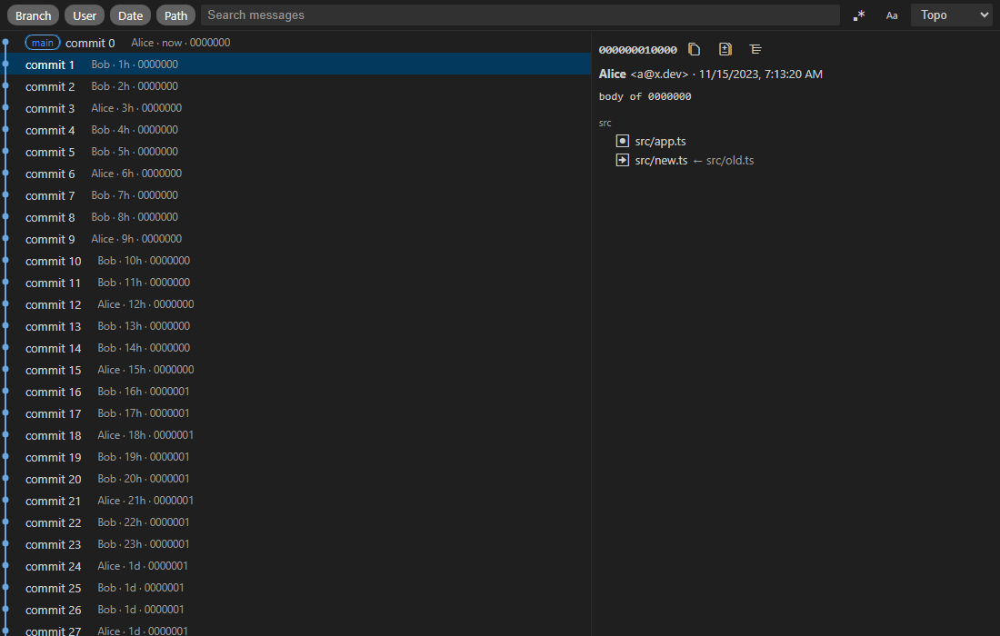

# GitTree

IntelliJ-grade Git integration for VS Code: changelists **and** native
staging, a color-coded 100k-commit log graph, drag-and-drop interactive
rebase, a true 3-pane merge editor with a real editor in the result pane,
IntelliJ-style shelve, and an operation-scoped Local History failsafe.



## Quick start

1. Install GitTree and open any git repository.
2. Choose a mode when asked — **Takeover** (GitTree runs the SCM view,
   reversible per workspace) or **Companion** (side by side with the
   built-in git). Nothing changes without this consent.
3. Run **GitTree: Getting Started Walkthrough** — it can generate a
   disposable [playground repository](docs/faq.md) to practice a commit, a
   conflict resolution and the log without touching your real projects.

New to GitTree from the built-in extension? See
[docs/migration-from-builtin.md](docs/migration-from-builtin.md). Full
keyboard reference (including the optional IntelliJ keymap):
[docs/keyboard.md](docs/keyboard.md). Every setting:
[docs/settings.md](docs/settings.md).

## Feature parity with IntelliJ IDEA Ultimate

Derived from [FEATURES.md](FEATURES.md), the project's parity specification.

### 1 · Editor integration ✅

Color-coded gutter line tracking with click-to-diff popup, inline hunk
rollback and hunk staging; toggleable blame annotations with author/date/sha,
age heat-map fading and click-through to the log; status-bar branch widget
opening the branches popup.

### 2 · Branch management ✅

Searchable popup with Current/Recent/Local/Remote categories and starred
favorites; **Smart Checkout** (auto-stash → checkout → unstash, with conflict
resolution when needed); per-branch actions: checkout, checkout-and-rebase
onto current, new branch from, compare with current, diff with working tree,
rename, delete, push.

### 3 · Commit lifecycle ✅

Both paradigms, switchable at any time: **changelists** (index-bypassing,
multiple lists, active list, new changes auto-adopted) and **staging**
(Staged/Unstaged with hunk- and line-level staging from the diff). Pre-commit
checks: reformat changed lines, optimize imports, analyze, TODO scan,
cleanup. Amend checkbox, GPG sign toggle, commit message history.

### 4 · Log & history ✅

Virtualized graph proven at 100k commits (60 fps scroll); Date/Topo/
**IntelliSort** orders; intersecting Branch/User (autocompleted)/Date/Path
filters plus regex text search; right-click revision actions: interactive
rebase, undo commit, revert, cherry-pick, drop; file history with rename
following. Screen-reader labels and a color-blind-safe palette included.

### 5 · 3-way merge resolution ✅

Yours/Result/Theirs panes where the result is a real editor (IntelliSense,
your keybindings); chevron accepts per side, **magic wand** auto-resolving
non-overlapping conflicts, F7/Shift+F7 navigation, accept-all per file or
session, byte-exact CRLF handling.


### 6 · Stash & shelve ✅

Complete stash GUI (push with file subset, apply/pop with `--index`, branch
from stash, diff vs working tree). IntelliJ-style **shelf**: patches stored
*outside* `.git` — they survive repo deletion — with validated patch editing,
import/export, and full or partial unshelve through a conflict-safe apply
ladder.

### 7 · GitHub/GitLab review ⏭️ skipped by decision

The provider-integration phase (PR list, in-IDE review, timeline) was
deliberately not built — it requires live provider accounts this project
does not use. Rationale and a future-implementer guide:
[docs/plan/PHASE-08-provider-integrations.md](docs/plan/PHASE-08-provider-integrations.md).
Git-protocol work against any remote (including self-hosted) is unaffected.

### 8 · Local History failsafe ✅

Automatic snapshots before/after every destructive operation (reset, rebase,
checkout-with-changes, stash/shelve-with-remove, …) plus optional save-time
snapshots; Timeline view integration; diff, restore, file recovery and
commit recovery from the reflog; size/age-budgeted GC.

## Requirements

- git ≥ 2.36 recommended (older versions degrade gracefully; features that
  need newer git, like FSMonitor suggestions, gate themselves on capability).
- VS Code ≥ 1.96. No accounts, no tokens, nothing leaves your machine.

## Development

```sh
npm install
npm run watch             # esbuild watch → dist/extension.js  (F5 to debug)
npm run check             # typecheck + lint + unit tests
npm run test:integration  # @vscode/test-electron against fixture repos
npm run test:perf         # §13 performance budgets (run in isolation)
npm run package           # vsce package --pre-release
```

Build blueprint: [IMPLEMENTATION_PLAN.md](IMPLEMENTATION_PLAN.md) and
[docs/plan/](docs/plan/). Benchmarks: [docs/perf.md](docs/perf.md).
