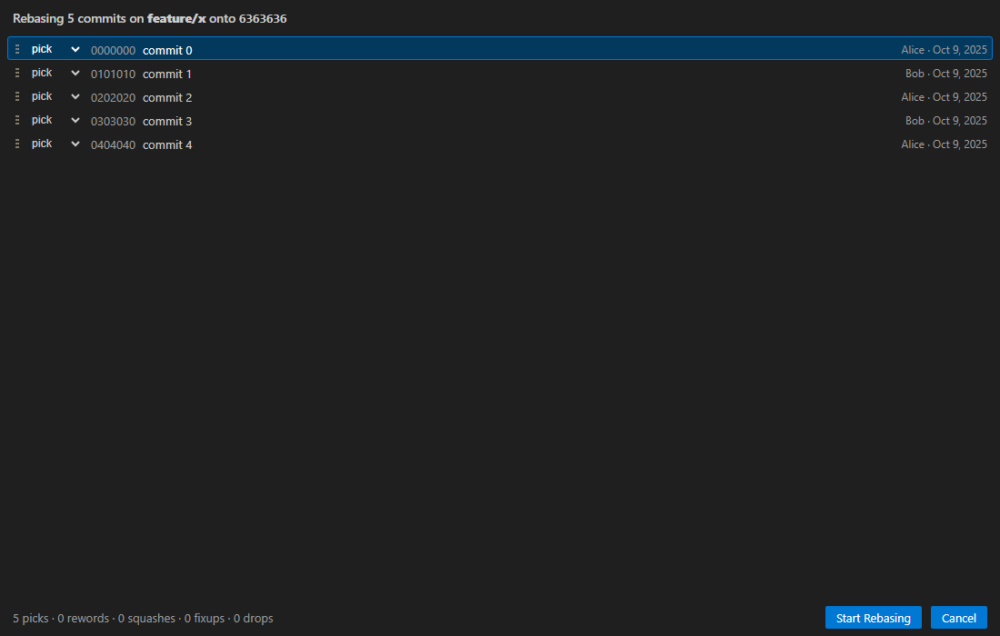

# GitTree

IntelliJ-grade Git integration for VS Code: a real commit tool window with
tri-state checkboxes and per-change inclusion, a four-pane Git tool window
over a 100k-commit graph, a branches popup that is an action hub, dialogs
that expose the actual git flags and show you the command before it runs,
a true 3-pane merge editor with a real editor in the result pane,
IntelliJ-style shelve, worktree management, and an operation-scoped
Local History failsafe.


## Quick start

1. Install GitTree and open any git repository.
2. Open the **GitTree** container in the activity bar. There is nothing to
   configure and no mode to pick: GitTree brings its own views, commit window,
   change bars and diff controls, so it neither needs nor touches the built-in
   Git extension. Leave that one enabled or disable it — GitTree behaves the
   same either way.
3. Run **GitTree: Getting Started Walkthrough** — it can generate a
   disposable [playground repository](docs/faq.md) to practice a commit, a
   conflict resolution and the log without touching your real projects.

New to GitTree from the built-in extension? See
[docs/migration-from-builtin.md](docs/migration-from-builtin.md). Full
keyboard reference (including the optional IntelliJ keymap):
[docs/keyboard.md](docs/keyboard.md). Every setting:
[docs/settings.md](docs/settings.md).

## Feature parity with IntelliJ IDEA Ultimate

Scored against [FEATURES.md](FEATURES.md) — rewritten in 2026-08 so that **every item carries a
*shape* criterion** (which container, which toolbar, which menu) alongside its behaviour, after
a review found the previous spec described capabilities without containers. The line-by-line
audit is [docs/parity-audit.md](docs/parity-audit.md); the measured inventory is
[docs/intellij-gap-analysis.md](docs/intellij-gap-analysis.md); divergences kept on purpose are
registered once in [docs/deviations.md](docs/deviations.md).

Measured over that inventory: **118 at parity · 33 partial · 79 absent** (from 75 / 36 / 122
before the 2026-08 rebuild). ✅ below means shape *and* behaviour; 🟡 means it works but sits in
a different kind of surface, and each one is a registered deviation.

### 1 · Editor integration 🟡

Gutter line tracking with hunk stage/unstage/revert and show-diff in the change popup;
toggleable blame with author/date/sha, an age heat-map and click-through to the log;
status-bar branch widget opening the branches popup. *Partial: the hunk popup is VS Code's,
and the widget is in the status bar rather than a top toolbar.*

### 2 · Branch management ✅

The branches popup is an **action hub**: top-level verbs (Update Project, Commit, Push, New
Branch, Checkout Tag or Revision) before any branch, sections for Current/Favorites/Recent/
Local/Remote/Tags, **folder rows** that drill in with a `‹ Back` row while typing searches flat
across every level, a header gear and incoming/outgoing toggle, and a `›` **submenu per row**
carrying the full reference list — including `Merge 'X' into '<current>'`, which before this
rebuild was reachable only by dragging. **Smart Checkout** intercepts a blocked checkout and
offers stash → checkout → unstash.

### 3 · Commit lifecycle ✅

One **commit tool window** with `Commit | Shelf` tabs, a toolbar strip, folder rows with
**tri-state checkboxes**, per-change include checkboxes with `N differences, M included`, a
real message editor with history and templates, and an options gear (author, sign-off, deferred
checks). Both paradigms — **changelists** and **staging** — switchable at any time.

### 4 · Log & history ✅

A bottom **Git tool window** with `Log | Console` tabs and **four panes** — Branches (with its
own icon rail), Commits, Changed Files, Commit Details — in persisted splitters. Graph proven
at 100k commits, Date/Topo/**IntelliSort**, intersecting filters, regex search, go-to-hash, and
the full commit context menu (interactive rebase, fixup/squash, push-all-up-to-here, reset
including **Keep**, show repository at revision). The **Console** tab records every git command
run, with secrets redacted.

### 5 · 3-way merge resolution ✅

A **`Files Merged with Conflicts`** gate, then Yours/Result/Theirs panes where the result is a
real editor (IntelliSense, your keybindings). `Apply non-conflicting changes` as **Left · All ·
Right**, a live `No changes. N conflicts.` counter, per-side **Show Details**, explicit
Accept Yours/Theirs, chevron accepts, F7 navigation, byte-exact CRLF handling.



### 6 · Stash & shelve ✅

Full stash GUI plus **dialogs** exposing the real flags (`--keep-index`, `--include-untracked`,
`--all`, `--staged`) and an Unstash dialog with pop/reinstate-index, a target changelist and an
inline diff of the file *inside* the stash. IntelliJ-style **shelf**: patches stored *outside*
`.git`, so they survive repo deletion, with partial shelve and import/export.

### 7 · GitHub/GitLab review ⏭️ skipped by decision

The provider-integration phase (PR list, in-IDE review, timeline) was deliberately not built —
it requires live provider accounts this project does not use. Rationale:
[docs/plan/PHASE-08-provider-integrations.md](docs/plan/PHASE-08-provider-integrations.md).
Git-protocol work against any remote (including self-hosted) is unaffected.

### 8 · Local History failsafe ✅

Automatic snapshots before every destructive operation (reset, rebase, checkout-with-changes,
stash/shelve-with-remove, rollback, …) plus optional save-time snapshots; byte-exact restore
with its own undo, file and commit recovery from the reflog, size/age-budgeted GC.

### 9 · Dialogs, popups and the action hub ✅

Twelve **option-bearing dialogs** — Push, Update Project, Merge, Rebase, Reset, Rollback,
Cherry-Pick, Stash, Unstash, Apply Patch, Clone, Manage Remotes — on IntelliJ's *Modify
options* pattern: a compact form plus a dropdown of the real git flags, with contradictory
combinations rejected *with reasons*. **Every dialog shows the exact command it will run.**
`` Alt+` `` opens the **VCS Operations Popup**, listing every action applicable right now.

### 10 · Worktrees ✅

A Worktrees view (path, branch, locked/prunable) with Open · Remove · Lock · Unlock · Prune,
and a **New Worktree** dialog with three branch modes and a sibling default location. Removing
a dirty worktree is refused with git's own reason.

## Requirements

- git ≥ 2.36 recommended (older versions degrade gracefully; features that
  need newer git, like FSMonitor suggestions, gate themselves on capability).
- VS Code ≥ 1.96. No accounts, no tokens, nothing leaves your machine.

## Development

```sh
npm install
npm run watch             # esbuild watch → dist/extension.js  (F5 to debug)
npm run check             # typecheck + lint + unit tests
npm run test:integration  # @vscode/test-electron against fixture repos
npm run test:perf         # §13 performance budgets (run in isolation)
npm run package           # vsce package --pre-release
```

Build blueprint: [IMPLEMENTATION_PLAN.md](IMPLEMENTATION_PLAN.md) and
[docs/plan/](docs/plan/). Benchmarks: [docs/perf.md](docs/perf.md).
